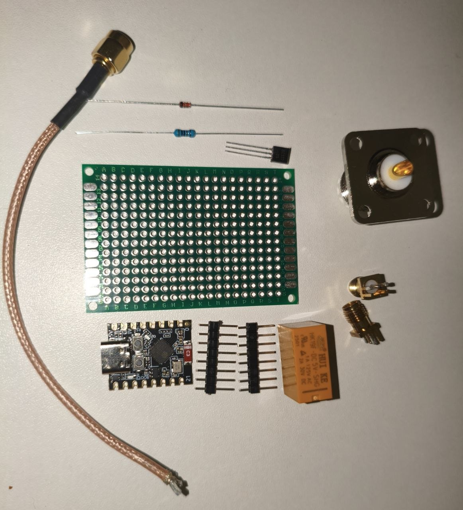
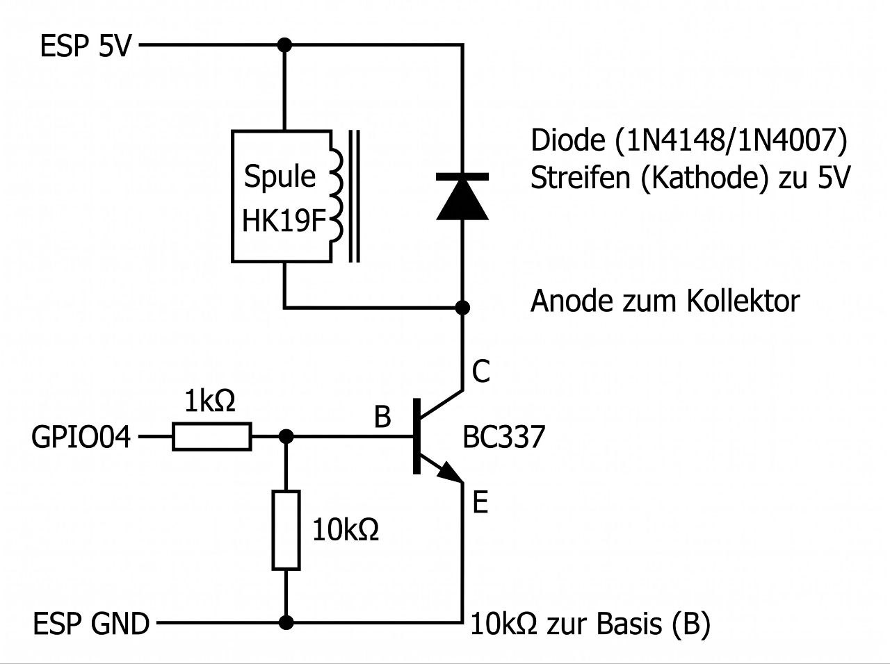
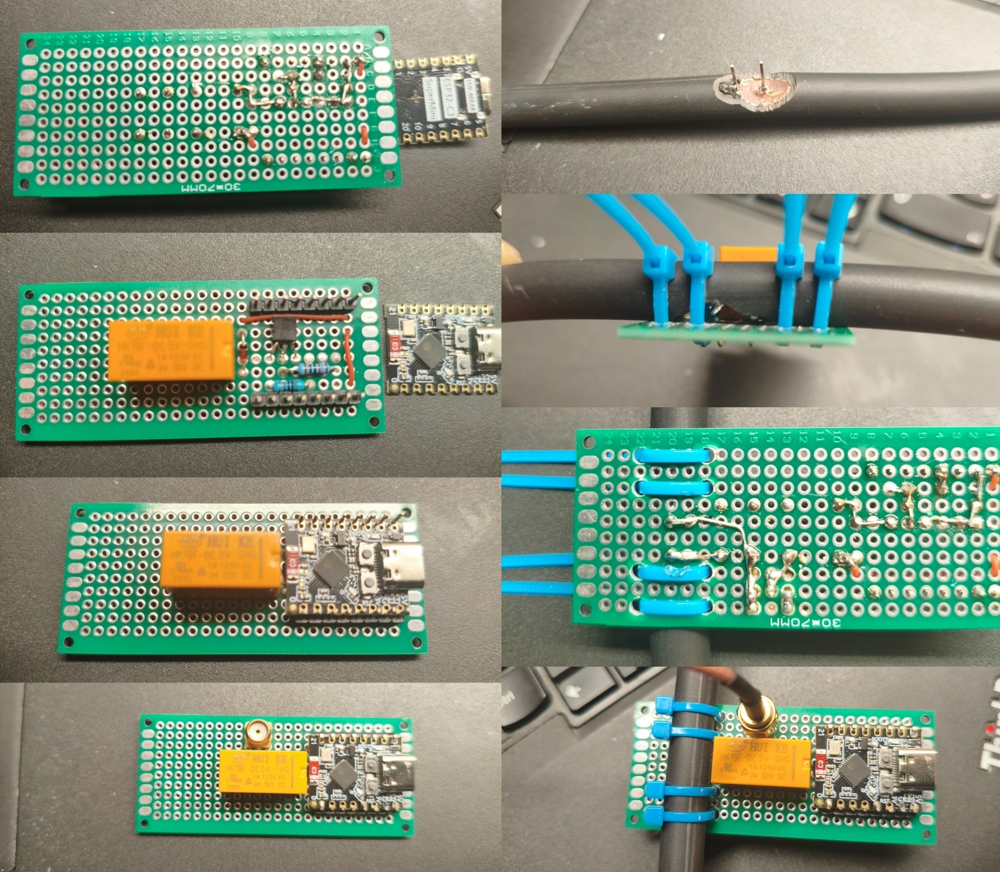

# T/R switch (optional): protect an SDR on the same antenna

Deutsch: [TRSWITCH_DE.md](TRSWITCH_DE.md) · Back to the [README](README.md)

If an RTL-SDR dongle (S-meter / RF waterfall) listens on the same antenna as the AE-5900, the transmitter's power must not reach the SDR input. This small add-on does that automatically: an ESP32-C3 with a relay **grounds the SDR branch while the radio transmits** and connects it again for receiving. It is controlled by the web interface and needs no extra software.

This is optional. Without it nothing changes.



## How it works

1. You press PTT (browser, Hamlib/rigctl, digimode software, CQ/QSO playback, everything goes through the same path).
2. The program tells the ESP32 "TX". The ESP32 releases the relay, the SDR input is grounded, and the ESP32 confirms.
3. The program waits for the **lead time**, then sets PTT on the radio.
4. After the transmission PTT is released first. After the **hold time** the ESP32 connects the SDR again.

**Fail-safe:** the relay is de-energised in the grounded position. A power failure, a crash, a pulled USB cable or a lost connection therefore always ends with the SDR grounded. The ESP32 also goes there by itself if it gets no heartbeat from the Raspberry Pi for 3 seconds.

**If the ESP32 does not confirm, the radio does not transmit.** A red message appears and the PTT button jumps back.

> Note: the protection covers every transmission that the program triggers, including the VOX of the web interface (it is a software VOX in the program, see the changelog). The VOX of the radio itself is not used any more; if it is still switched on in the AE-5900 menu, the radio would start to transmit without the ESP32 knowing, so keep it off in the radio menu.

## Parts

Adapt the list to your own build (connector types depend on your SDR and cabling).

| Part | Note |
|---|---|
| ESP32-C3 Super Mini | USB-C, appears as a serial device on the Raspberry Pi |
| Relay HK19F-DC5V (5 V coil, 1 changeover contact) | the one used in the prototype; switching times 6 ms / 4 ms |
| Transistor BC337 (or 2N2222) | drives the relay coil |
| Diode 1N4148 or 1N4007 | across the coil (protects the transistor) |
| Resistor 1 kOhm | GPIO4 to the transistor base |
| Resistor 10 kOhm | base to GND (relay stays off while the ESP32 boots) |
| USB cable USB-C | ESP32 to a USB port of the Raspberry Pi |
| PL (PL259 / SO-239) T-piece or tap | into the antenna line |
| SMA connector | to the SDR dongle |
| Short coax piece (e.g. RG174) | SDR branch, keep it as short as possible |
| Small enclosure | optional |

## Schematic

```
 ESP 5V ─────────┬───────────────┐
                 │               │
              ┌──┴──┐          ──┴──   diode 1N4148 / 1N4007
              │coil │          ▲       stripe (cathode) to 5 V
              │HK19F│          │
              └──┬──┘          │
                 ├─────────────┘       anode to the collector
                 │
              C (collector)
 GPIO4 ─[1k]─ B   BC337
              E (emitter)
                 │
 ESP GND ────────┴──────── 10k ── to the base (B)
```

Relay contacts (coax):

| Relay contact | Connected to |
|---|---|
| COM | SDR input (centre conductor) |
| NC (closed when the relay is de-energised) | ground / shield |
| NO | antenna line (centre conductor) |

De-energised: COM-NC, the SDR input sits on ground (safe). Energised: COM-NO, the SDR is connected to the antenna (receive).



Build notes from the prototype:

- Keep all HF wires **extremely short**. In the prototype the NO contact is fed from the antenna line through a small opening in the cable.
- With this build no additional 100 nF capacitor was necessary.
- The 6 ms / 4 ms switching times of the relay are far below the default lead and hold time of 50 ms.
- Before connecting the SDR check with a multimeter (continuity): de-energised COM-NC conducts, energised (press "Test relay") COM-NO conducts.
- Test the first transmissions with low power or a dummy load and check the level at the SDR. A normal relay is not a real RF relay; the short to ground on the SDR side helps a lot, but check your own build.



## Flash the ESP32-C3

The sketch is in the folder `ino` of this repository (`AE5900_TR_Switch.ino`).

1. Arduino IDE with the ESP32 board package installed.
2. Board: **ESP32C3 Dev Module**.
3. **USB CDC On Boot: Enabled** (important, otherwise no serial device appears).
4. Everything else default, upload.

The onboard LED shows the state: on = RX (SDR connected), off = TX / safe.

## Setup

1. Connect the ESP32 with the USB cable to the Raspberry Pi.
2. Open Setup & Sync -> **Radio & keys** -> "T/R switch".
3. The status line shows whether the ESP32 was found (port, firmware, relay position). The port is found automatically (USB devices from Espressif only). You can enter a port like `/dev/ttyACM0` by hand.
4. Press **Test relay**: the relay clicks RX, TX, RX and shows the times.
5. Tick **Use T/R switch**. This only works while the ESP32 is connected.
6. **Lead time** and **Hold time** (default 50 ms each). Longer times are safer, shorter ones lose less of the beginning of your speech.

Switch off: the ESP32 is not used any more and stays in the grounded position.

## Troubleshooting

- **"ESP32 not connected":** check the USB cable (a charge-only cable does not work) and whether `ls /dev/serial/by-id/` shows an `Espressif` device. If the sketch was flashed without "USB CDC On Boot: Enabled", nothing answers.
- **"no answer (wrong firmware?)":** the device answers but not with the T/R protocol, flash the sketch again.
- **"ESP32 did not confirm":** the program refuses to transmit. Check the log: `sudo journalctl _SYSTEMD_USER_UNIT=ae5900.service -f` (lines with `[T/R]`).
- **Relay does not click:** check the transistor orientation (collector to the coil) and the 5 V supply of the coil.
- **First part of the speech missing:** reduce the lead time.
