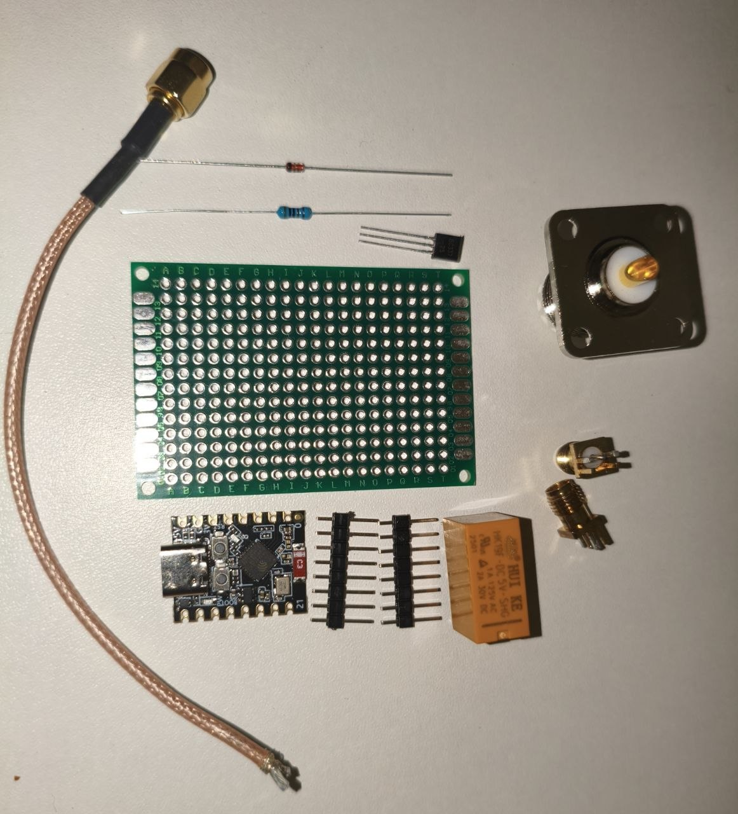
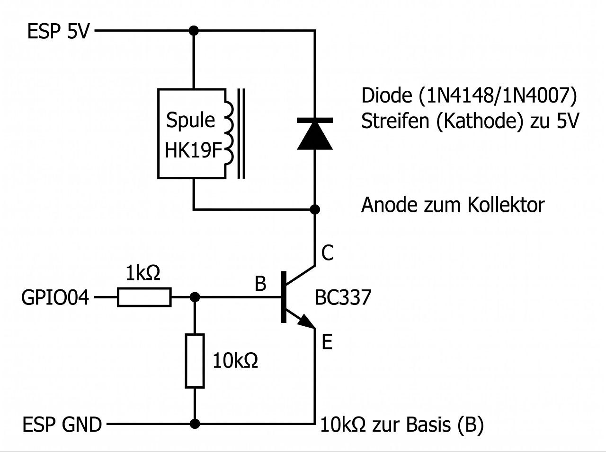
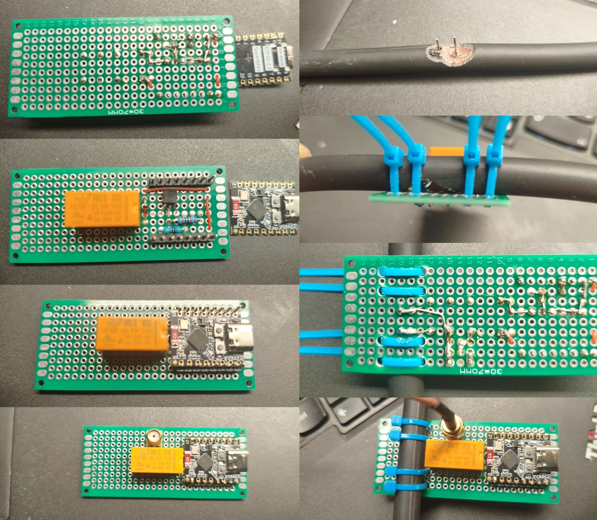

# T/R-Umschalter (optional): SDR an der gleichen Antenne schützen

English: [TRSWITCH.md](TRSWITCH.md) · Zurück zur [README_DE](README_DE.md)

Hört ein RTL-SDR-Dongle (S-Meter / HF-Wasserfall) an der gleichen Antenne wie das AE-5900, darf die Sendeleistung nicht an den SDR-Eingang gelangen. Dieses kleine Zusatzgerät erledigt das automatisch: Ein ESP32-C3 mit Relais **erdet den SDR-Zweig, solange das Funkgerät sendet**, und verbindet ihn zum Empfangen wieder. Die Steuerung läuft über die Weboberfläche, zusätzliche Software ist nicht nötig.

Das ist optional. Ohne den Umschalter ändert sich nichts.



## So funktioniert es

1. Du drückst PTT (Browser, Hamlib/rigctl, Digimode-Software, CQ/QSO-Wiedergabe, alles läuft über denselben Weg).
2. Das Programm sagt dem ESP32 „TX“. Der ESP32 lässt das Relais abfallen, der SDR-Eingang ist geerdet, und der ESP32 bestätigt.
3. Das Programm wartet die **Vorlaufzeit** ab und setzt dann PTT am Funkgerät.
4. Nach dem Senden wird zuerst PTT gelöst. Nach der **Nachlaufzeit** verbindet der ESP32 den SDR wieder.

**Ausfallsicher:** In der geerdeten Stellung ist das Relais stromlos. Stromausfall, Absturz, abgezogenes USB-Kabel oder eine verlorene Verbindung enden deshalb immer mit geerdetem SDR. Der ESP32 geht außerdem von selbst dorthin, wenn er 3 Sekunden lang keinen Heartbeat vom Raspberry Pi bekommt.

**Bestätigt der ESP32 nicht, wird nicht gesendet.** Es erscheint eine rote Meldung, und der PTT-Knopf springt zurück.

> Hinweis: Der Schutz gilt für jede Sendung, die das Programm auslöst, auch für das VOX der Weboberfläche (das ist eine Software-VOX im Programm, siehe Änderungsübersicht). Die VOX des Funkgeräts selbst wird nicht mehr benutzt; ist sie im Menü des AE-5900 noch eingeschaltet, würde das Funkgerät senden, ohne dass der ESP32 davon weiß. Im Funkgeräte-Menü bitte ausgeschaltet lassen.

## Teileliste

Passe die Liste an deinen Aufbau an (die Steckerarten hängen von SDR und Verkabelung ab).

| Teil | Hinweis |
|---|---|
| ESP32-C3 Super Mini | USB-C, erscheint am Raspberry Pi als serielles Gerät |
| Relais HK19F-DC5V (5-V-Spule, 1 Wechsler) | das im Prototyp verwendete; Schaltzeiten 6 ms / 4 ms |
| Transistor BC337 (oder 2N2222) | schaltet die Relaisspule |
| Diode 1N4148 oder 1N4007 | parallel zur Spule (schützt den Transistor) |
| Widerstand 1 kOhm | GPIO4 an die Transistorbasis |
| Widerstand 10 kOhm | Basis nach GND (Relais bleibt beim Booten des ESP32 aus) |
| USB-Kabel USB-C | ESP32 an einen USB-Port des Raspberry Pi |
| PL-Teile (PL259 / SO-239), T-Stück oder Abzweig | in die Antennenleitung |
| SMA-Anschluss | zum SDR-Dongle |
| Kurzes Koaxstück (z. B. RG174) | SDR-Zweig, so kurz wie möglich |
| Kleines Gehäuse | optional |

## Schaltung

```
 ESP 5V ─────────┬───────────────┐
                 │               │
              ┌──┴──┐          ──┴──   Diode 1N4148 / 1N4007
              │Spule│          ▲       Streifen (Kathode) zu 5 V
              │HK19F│          │
              └──┬──┘          │
                 ├─────────────┘       Anode zum Kollektor
                 │
              C (Kollektor)
 GPIO4 ─[1k]─ B   BC337
              E (Emitter)
                 │
 ESP GND ────────┴──────── 10k ── zur Basis (B)
```

Relaiskontakte (Koax):

| Relaiskontakt | Verbunden mit |
|---|---|
| COM | SDR-Eingang (Seele) |
| NC (geschlossen, wenn das Relais stromlos ist) | Masse / Schirm |
| NO | Antennenleitung (Seele) |

Stromlos: COM-NC, der SDR-Eingang liegt auf Masse (sicher). Angezogen: COM-NO, der SDR hängt an der Antenne (Empfang).



Hinweise aus dem Prototyp:

- Alle HF-Leitungen **extrem kurz** halten. Im Prototyp wird der NO-Kontakt durch eine kleine Öffnung im Kabel aus der Antennenleitung gespeist.
- Bei diesem Aufbau war kein zusätzlicher 100-nF-Kondensator nötig.
- Die Schaltzeiten des Relais (6 ms / 4 ms) liegen weit unter dem Standardwert von 50 ms für Vor- und Nachlauf.
- Vor dem Anschluss des SDR mit dem Multimeter (Durchgang) prüfen: Stromlos leitet COM-NC, angezogen (Knopf „Test relay“) leitet COM-NO.
- Die ersten Sendungen mit wenig Leistung oder an der Dummyload testen und den Pegel am SDR kontrollieren. Ein normales Relais ist kein echtes HF-Relais; der Kurzschluss gegen Masse auf der SDR-Seite hilft sehr, aber prüfe deinen eigenen Aufbau.



## ESP32-C3 flashen

Der Sketch liegt im Ordner `ino` dieses Repositorys (`AE5900_TR_Switch.ino`).

1. Arduino IDE mit installiertem ESP32-Boardpaket.
2. Board: **ESP32C3 Dev Module**.
3. **USB CDC On Boot: Enabled** (wichtig, sonst erscheint kein serielles Gerät).
4. Alles andere Standard, hochladen.

Die LED auf dem Board zeigt den Zustand: an = RX (SDR verbunden), aus = TX / sicher.

## Einrichtung

1. ESP32 mit dem USB-Kabel an den Raspberry Pi anschließen.
2. Setup & Sync -> **Radio & keys** -> „T/R switch“ öffnen.
3. Die Statuszeile zeigt, ob der ESP32 gefunden wurde (Port, Firmware, Relaisstellung). Der Port wird automatisch gefunden (nur USB-Geräte von Espressif). Ein Port wie `/dev/ttyACM0` lässt sich auch von Hand eintragen.
4. **Test relay** drücken: Das Relais klackt RX, TX, RX, und die Zeiten werden angezeigt.
5. **Use T/R switch** anhaken. Das geht nur, solange der ESP32 verbunden ist.
6. **Lead time** (Vorlauf) und **Hold time** (Nachlauf), Standard je 50 ms. Längere Zeiten sind sicherer, kürzere verlieren weniger vom Anfang der Sprache.

Ausschalten: Der ESP32 wird nicht mehr benutzt und bleibt in der geerdeten Stellung.

## Fehlersuche

- **„ESP32 not connected“:** USB-Kabel prüfen (ein reines Ladekabel funktioniert nicht) und ob `ls /dev/serial/by-id/` ein `Espressif`-Gerät zeigt. Wurde der Sketch ohne „USB CDC On Boot: Enabled“ geflasht, antwortet nichts.
- **„no answer (wrong firmware?)“:** Das Gerät antwortet, aber nicht mit dem T/R-Protokoll. Den Sketch erneut flashen.
- **„ESP32 did not confirm“:** Das Programm verweigert das Senden. Log prüfen: `sudo journalctl _SYSTEMD_USER_UNIT=ae5900.service -f` (Zeilen mit `[T/R]`).
- **Relais klackt nicht:** Lage des Transistors (Kollektor an die Spule) und die 5-V-Versorgung der Spule prüfen.
- **Anfang der Sprache fehlt:** Vorlaufzeit verkürzen.
